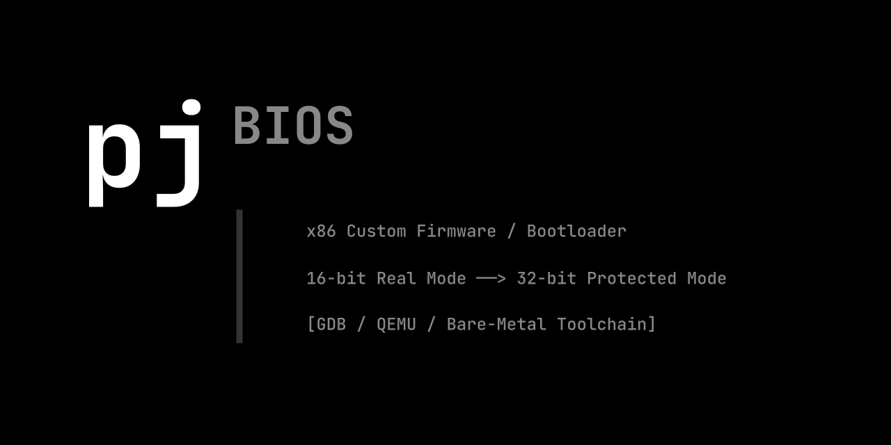

# pjBIOS

## Overview
pjBIOS is a didactic project focused on learning how to program an x86 BIOS from scratch.
- x86 Custom Firmware / Bootloader
- 16-bit Real Mode -> 32-bit Protected Mode
- [GDB / QEMU / Bare-Metal Toolchain]

## License
This project is licensed under the **MIT License**.

I chose this license to maximize the educational value and accessibility 
of this work. You are free to use, modify, and distribute this code, 
even in proprietary projects, as long as you keep the original copyright 
notice and license text.

See the [LICENSE](LICENSE) file for the full legal text.

## Author
**mtdeve**: [GitHub Profile](https://github.com/mtdeve), [Email](mailto:mirkotardio@web.de)
  
Feel free to contact me if you have any questions regarding this project!

## Documentation
( I will be posting official documentation in this section shortly)

* Check the local documentation entry point: [Official Documentation](https://mtdeve.github.io/pjBIOS/). (soon evailable)
  
## 💖 Support the Project

If you find this project useful and would like to support its ongoing development, consider becoming a sponsor! Your support helps cover development time, maintenance, and new features.

